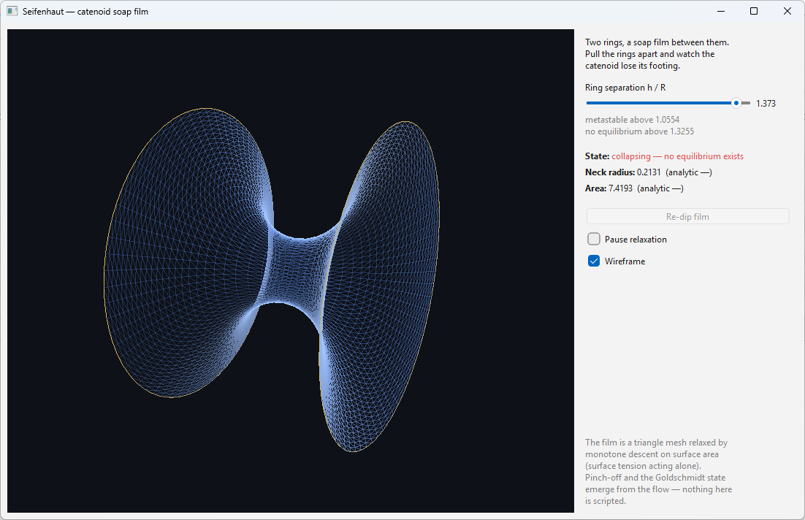

# Seifenhaut

A soap film between two rings, simulated honestly.

Stretch a soap film between two coaxial wire rings and it takes the shape of
a **catenoid** — the only non-trivial minimal surface of revolution,
`r(z) = c·cosh(z/c)`. Pull the rings apart and the film survives only up to a
hard geometric limit: for rings of radius `R`, the boundary condition
`R = c·cosh(h/2c)` has no solution once the separation exceeds

```
(h/R)_max = 2u*/cosh(u*) ≈ 1.32549,   where coth(u*) = u*
```

Beyond that the film has nowhere to go but the **Goldschmidt solution** — it
pinches off at the neck and snaps into two flat disks. There is also a
metastable window: above `h/R ≈ 1.0554` two disks already have less total
area, yet the catenoid remains a local minimum and the film survives until
the geometric limit. Once burst, pushing the rings back together does not
restore it — the hysteresis you see in the app is the same one you see over
a real soap bath.



## What is actually simulated

The film is a triangle mesh pinned to the two rings and relaxed by **monotone
gradient descent on total surface area** — surface tension acting alone,
which is exactly what shapes a real (massless, quasi-static) soap film:

- The area gradient is computed exactly per triangle in cross-product form
  (`∂A/∂a = ½ n̂ × (c − b)`), which stays bounded even on degenerate
  triangles — unlike the clamped-cotangent form, it is always a true descent
  direction.
- The motion is projected onto the vertex normal. In the continuum the area
  gradient is purely normal; the spurious tangential component of its
  discrete counterpart does next to nothing for the area but slowly drags
  vertices across the surface until edges collapse and the mesh degrades.
- A diagonal (Jacobi-style) preconditioner assembled from cotangent weights
  rescales the step per vertex. It changes only the step size, not the fixed
  point: a vanishing normal gradient is exactly zero mean curvature, i.e.
  the converged mesh is a discrete minimal surface.
- A backtracking safeguard rejects any step that would increase the area and
  retries smaller; since every displacement is proportional to the damping
  factor, a sufficiently damped step is always accepted. The scheme is
  monotone — divergence is impossible by construction.
- When the neck radius falls below a small threshold the tube is cut. Each
  half is resampled onto a clean radially-graded disk mesh initialised as a
  smooth shallow dome, and then settles by **implicit mean curvature flow**
  (implicit fairing: `(M + dt·L) x' = M x`, matrix-free conjugate gradient,
  positively clamped weights for positive definiteness). The flattening is
  a stiff diffusion problem — the dome must flatten from the pinned rim
  inwards — and one unconditionally stable implicit step does the work of
  thousands of explicit ones.

Nothing is scripted. The catenoid shape, the critical separation, the
collapse and the two-disk end state all emerge from area minimization on the
mesh. The analytic solution is used only to *check* the simulation, never to
drive it. The solver is plain C++ with hand-rolled vector math and a
hand-rolled CG — no dependencies beyond Qt for the UI.

## Verification

`tests/verify.cpp` compares the mesh solver against the closed-form
catenoid. Output on a 48×64 mesh (32×48 for the ramp):

```
Equilibrium at h/R = 0.8:
  neck radius   = 0.91050   (analytic 0.91074)
  max profile rel. error = 1.9e-03
  area          = 4.881527  (analytic 4.883793, rel err 4.6e-04)

Quasi-static ramp:
  measured critical h/R = 1.3300  (analytic 1.32549, off by 0.34%)

Post-collapse (Goldschmidt) state:
  two separate films, total area 6.2653  (2πR² = 6.2832, rel err 2.9e-03)
  max deviation from the ring planes 5.8e-08  (the disks are truly flat)
```

The residual post-collapse area error is dominated by the inscribed-polygon
effect: a triangulated disk with `n` angular segments has area
`(n/2)·sin(2π/n)·R²`, about 0.29% below `πR²` at `n = 48`.

## Limitations, stated plainly

- The relaxation flow is *quasi-static area minimization*, not inertial
  dynamics. The transient you see during collapse is the descent path of the
  optimizer, not the physical pinch-off of a real film (which is a
  finite-time singularity with its own self-similar scaling — see Eggers).
  Equilibria, the stability threshold and the end states are physical; the
  time axis in between is not.
- The pinch is triggered at a small finite neck radius (default `0.05 R`)
  while the mesh is still well-shaped. The measured critical separation is
  insensitive to this choice because beyond `(h/R)_max` no equilibrium
  exists at all — the collapse is already irreversible when the cut happens.
- The instant of rupture is shortcut. The deep funnel left by the cut is
  nearly minimal (a catenoid half has zero mean curvature), so quasi-static
  relaxation would retract its thin tip at a vanishing rate; a real film
  crosses this regime on the fast inertial timescale (Taylor-Culick
  retraction), which this model does not contain. Each half is therefore
  re-initialised as a smooth shallow dome of a fraction of the funnel depth
  and relaxes from there. The Goldschmidt end state is unaffected.
- No remeshing during the collapse. The structured tube mesh grows
  anisotropic near the neck late in the collapse; the monotone safeguard
  keeps this from causing trouble, at the cost of slower convergence there.

## Build

Requires Qt 6 (Widgets + OpenGLWidgets) and a C++17 compiler. No other
dependencies — the solver is plain C++ with hand-rolled vector math.

```
cmake -B build -DCMAKE_BUILD_TYPE=Release
cmake --build build -j
./build/seifenhaut     # the app
./build/verify         # the verification suite (takes ~2 minutes)
```

## Controls

- **Slider** — ring separation `h/R`. Cross 1.3255 and watch.
- **Re-dip film** — after a collapse, dip the frame back into the soap bath
  (only works if the rings are close enough for a film to exist).
- **Mouse drag** — orbit; **wheel** — zoom; **Pause / Wireframe** — as named.

The panel shows the measured neck radius and area next to their analytic
values, live.

## License

MIT License

Copyright (c) 2026 Mykhailo Makarov

Permission is hereby granted, free of charge, to any person obtaining a copy
of this software and associated documentation files (the "Software"), to deal
in the Software without restriction, including without limitation the rights
to use, copy, modify, merge, publish, distribute, sublicense, and/or sell
copies of the Software, and to permit persons to whom the Software is
furnished to do so, subject to the following conditions:

The above copyright notice and this permission notice shall be included in all
copies or substantial portions of the Software.

THE SOFTWARE IS PROVIDED "AS IS", WITHOUT WARRANTY OF ANY KIND, EXPRESS OR
IMPLIED, INCLUDING BUT NOT LIMITED TO THE WARRANTIES OF MERCHANTABILITY,
FITNESS FOR A PARTICULAR PURPOSE AND NONINFRINGEMENT. IN NO EVENT SHALL THE
AUTHORS OR COPYRIGHT HOLDERS BE LIABLE FOR ANY CLAIM, DAMAGES OR OTHER
LIABILITY, WHETHER IN AN ACTION OF CONTRACT, TORT OR OTHERWISE, ARISING FROM,
OUT OF OR IN CONNECTION WITH THE SOFTWARE OR THE USE OR OTHER DEALINGS IN THE
SOFTWARE.

## Support

If you found this project interesting or useful, you can support my work:

[](https://github.com/sponsors/makarov-mm)
